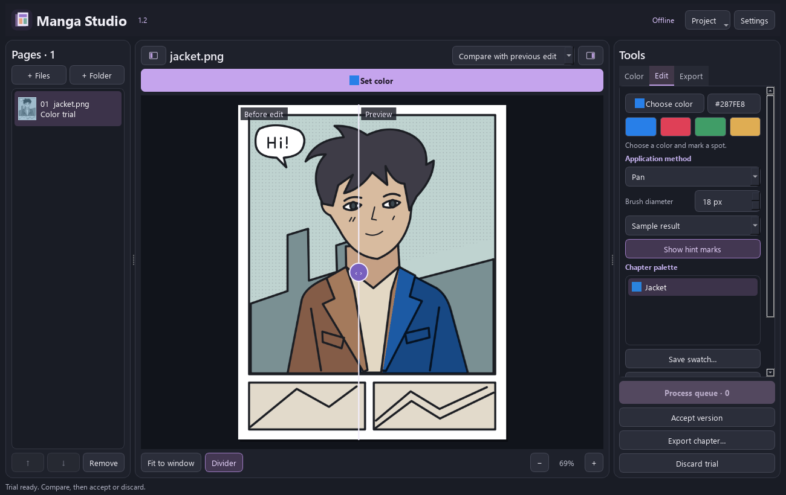

# Manga Studio 1.2

An offline Windows desktop editor for colorizing manga. Choose a swatch, mark a location, compare the result and accept or discard the trial. The editor keeps the original page dimensions and can preserve its linework and halftones. [Инструкция на русском](README.ru.md)

**d3l3tanttao** directs the project. **OpenAI Codex** (AI assistant) implemented and tested the desktop application. The neural colorizer and its color-hint input come from **qweasdd/manga-colorization-v2**. The desktop UI, selection tools, color transfer onto the scan, project/version management and export were implemented for this application. The original application is MIT-licensed. [Contributions](CREDITS.md) · [MIT License](LICENSE) · [Third-party terms](LICENSING.md)



## Install on Windows

Use Windows x64, Python 3.10 x64 with the Windows Python launcher, Git and PowerShell. Run these commands in the extracted repository. The setup script installs packages into a local virtual environment and builds a Windows launcher using the .NET Framework C# compiler. Allow several GB for the CUDA installation.

```powershell
.\setup.ps1 -Device CPU
& ".\Manga Studio 1.2.exe"
```

Click **Try the example**. The original jacket drawing and its prepared color guide are included. The sample editor, selection brush, lasso, palettes and export can be exercised without neural weights.

For automatic colorization of your own pages and AI hints, review the upstream terms and install the external engine and original checkpoints. To use the tested NVIDIA CUDA build:

```powershell
.\setup.ps1 -Device CUDA -InstallEngine -DownloadWeights
```

Choose `CPU` instead of `CUDA` for a processor-only installation. The engine checkout is pinned and both Google Drive downloads are SHA-256 checked before use. When downloading manually, put `generator.zip` and `net_rgb.pth` in `.models`, or select their folder in Settings. Keep the generator zip intact. The installed application runs offline. The small EXE starts the neighboring Python application and requires the installed runtime. [Upstream engine and weights](https://github.com/qweasdd/manga-colorization-v2)

## Color a jacket

1. Click **Set color** above the canvas. Pick a named swatch, click a quick color or enter a six-digit HEX value. Save a character's colors in the chapter palette. The selected color and brush diameter are remembered.
2. For a local edit, choose **Selection only · brush** or **Selection only · lasso**. Paint or draw the boundary. The tint follows the ink and tone of the scan. Pixels outside the selection stay unchanged. Use the view selector to compare with the image before the trial.
3. For a neural suggestion, choose **Guide the AI**, add one or more marks and click **Apply hints**. The model interprets the colors and can change nearby regions. The marks are hidden for comparison. **Accept version** writes a working PNG. **Discard trial** restores the previous state.
4. Pick from **original** or **result** with the eyedropper. Hold **Alt** to sample temporarily, or use **[** and **]** to change brush diameter. **Ctrl+Z** and **Ctrl+Y** undo and redo strokes.
5. Use **Export chapter** to write sequentially numbered PNGs into a new export directory. The progress dialog identifies unfinished pages. Chapter order, versions, trials, masks, swatches and the viewport are autosaved. Opening a 1.1 project creates a separate 1.2 copy.

Settings includes 25 offline interface locales, automatic Windows language detection and right-to-left layout. Changing the language reopens the window and restores the active project. Native Windows file dialogs follow the operating system language. [Translation coverage and review status](docs/LOCALIZATION.md)

## Development and verification

```powershell
.\.venv\Scripts\python.exe tests/check_release.py
.\.venv\Scripts\python.exe tests/check_desktop.py
```

The first suite runs without the external engine. It checks every catalog, renders the interface, exercises local color editing, pixel equality outside selections, cancellation, export and 1.1 migration. On Windows its font checks use installed system fonts. The second suite requires the pinned model and weights. It verifies chapter processing, hint trials, high-bit-depth scans, recovery, queue controls and CPU rendering. With CUDA available it also exercises GPU inference. Both suites use temporary chapters.

Working projects are stored under `.chapters`. For backups, copy the whole chapter project directory and keep its source scans. Original sources, private project data, model weights and virtual environments are excluded from Git. [1.2.0 changes](CHANGELOG.md)
