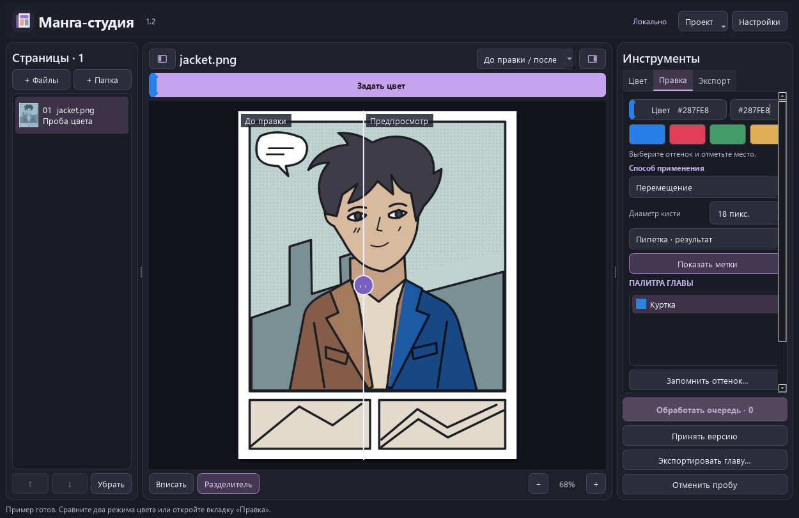

# Манга-студия 1.2

**d3l3tanttao** задаёт направление проекта и утверждает приоритеты. **OpenAI Codex**, ИИ-ассистент, реализовал приложение, графический интерфейс, обработку цвета на исходном скане, редактор, тесты и документацию. Нейросетевая раскраска и вход цветовых подсказок принадлежат исходному проекту **qweasdd/manga-colorization-v2**. [Подробный перечень вкладов](CREDITS.md)



## Установка

Нужны Windows x64, Python 3.10 x64 с командой `py`, Git и PowerShell. Откройте PowerShell в папке репозитория.

```powershell
.\setup.ps1 -Device CPU
& ".\Manga Studio 1.2.exe"
```

Кнопка **Попробовать на примере** откроет оригинальный рисунок с подготовленной цветовой картой. Для работы нейросети выберите устройство и установите движок с весами автора. Скрипт проверяет ревизию и контрольные суммы. Для NVIDIA выполните следующую команду, для процессора замените CUDA на CPU.

```powershell
.\setup.ps1 -Device CUDA -InstallEngine -DownloadWeights
```

При ручной установке положите `generator.zip` и `net_rgb.pth` в `.models` или укажите папку весов в настройках. EXE использует установленное рядом окружение. После установки интернет для работы не требуется. [Оригинальные веса](https://github.com/qweasdd/manga-colorization-v2)

## Как перекрасить куртку

1. Нажмите **Задать цвет** над холстом. Выберите синий образец или введите `#287FE8`. В палитре главы можно сохранить именованный оттенок персонажа.
2. Выберите **Только в выделении · кисть** или **Только в выделении · лассо**. Проведите кистью или обведите контур. Студия сохранит линии и тени, а пиксели за границей выделения останутся прежними.
3. Для подсказки модели выберите **Подсказать ИИ** и поставьте метки. Нажмите **Применить подсказки**. Сравните результат с изображением до правки и нажмите **Принять версию** или **Отменить пробу**. Метки можно показать отдельно.
4. Для пипетки укажите источник цвета. Удерживайте **Alt** для временной пипетки. Клавиши **[** и **]** меняют диаметр, **Ctrl+Z** и **Ctrl+Y** отменяют и возвращают штрихи.
5. В окне **Экспортировать главу** проверьте число готовых страниц. В новой папке появятся `0001.png`, `0002.png` и последующие файлы по порядку списка. У проекта сохраняются версии, пробы, штрихи, палитра и положение холста.

Старую главу откройте через меню **Проект**. Студия создаст отдельную копию проекта 1.1 в формате 1.2. Для резервной копии сохраните папку главы целиком, включая `chapter.json`, цветовые карты, версии и исходные сканы.

Язык выбирается в **Настройках**. Доступно 25 локализаций. После смены языка окно откроется заново с текущим проектом. Проверки переводов и статус вычитки перечислены отдельно. [Локализация](docs/LOCALIZATION.md) · [Условия распространения](LICENSING.md)
