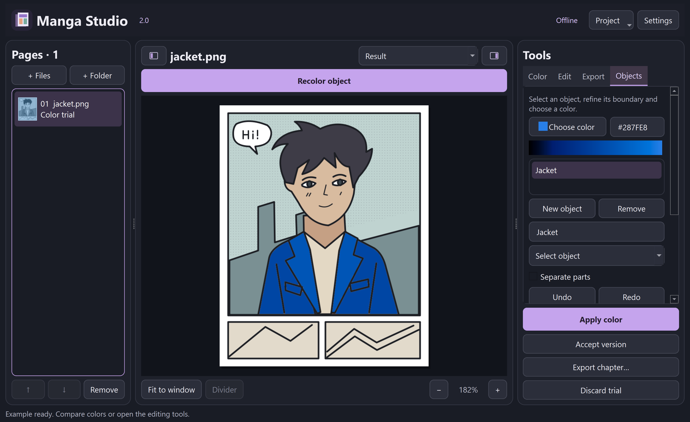

# Manga Studio 2.0

> Historical documentation for 2.0. Its engine and install flags were retired. Use the [current instructions](../README.md) for 2.2.

An offline Windows colorization editor with object selection, editable materials, protected regions, reference palettes and 25 interface locales. [Русский](CLASSIC-2.0.ru.md)

**d3l3tanttao** directs the project. **OpenAI Codex**, an AI assistant, implemented the application, interface, color rendering, integrations, tests and documentation. Neural colorization is by **qweasdd**. Object selection uses **Meta SAM 2.1**. [Credits](../CREDITS.md)



The bundled original illustration is shown with interactively selected contour regions. This screenshot is an interface example, not a SAM accuracy benchmark.

## Install

Windows x64, Python 3.10 x64 available through `py`, Git and PowerShell are required.

```powershell
.\setup.ps1 -Device CUDA -InstallEngine -DownloadWeights -InstallSelection
& '.\Manga Studio 2.0.exe'
```

Use `-Device CPU` without an NVIDIA GPU. The launcher uses a local Python environment. The source archive excludes Python, models, upstream trees, user chapters and manga examples. Setup verifies pinned revisions and checkpoint hashes. Image processing runs locally after installation.

`-InstallSelection` downloads SAM 2.1 Small. Add `-SelectionModel Large` to install Large instead. Native Windows inference does not require WSL or the optional SAM CUDA extension. Our refinement handles scan-resolution boundaries. Without SAM, manual regions and the explicitly non-semantic contour tool remain available. The original jacket example works without model downloads.

## Recolor an object

1. Click **Recolor object**. Choose a color or enter HEX at the top.
2. Click the object. Shift or right-click excludes unwanted areas. Enable **Separate parts** for disconnected visible regions. Each positive point is analyzed independently with all negative points, then the proposals are combined.
3. Review mask variants. Use region brushes, lasso or a panel boundary when needed. Undo works for selection refinements. Manual corrections survive further AI clicks; variants honoring your points are ranked first.
4. **Apply color**, compare with the state before editing, then accept the version or discard the trial.
5. Lock an object to preserve its current pixels. **Restore original** in object settings protects scan pixels. **Protect background** proposes border-connected paper and asks you to check it.

Masks are proposals. The model can miss a sleeve or include hair. It does not reconstruct hidden anatomy or assign reliable body-part labels. Border-connected paper can include white clothing when a contour is open.

## Materials and references

Objects retain masks bound to source-pixel hashes, base colors, saturation and lightness. On white scan pixels, material colors reproduce the selected HEX within rounding; shading follows the scan. Optional black-fill lightening preserves thin dark strokes using an image-based heuristic and is disabled by default.

Character and material names link user-confirmed objects across a chapter. Applying a linked palette lists affected pages and saves new versions after confirmation. Automatic character recognition is not used.

Reference sampling takes a median from a user-selected material region, excluding extreme dark and bright samples where possible. It does not transfer reference geometry or lighting.

## Quality controls

- Legacy tint and exact grayscale-L modes remain. Tint is still the default.
- **Color and light** uses scan-guided upsampling and bounds lightness changes.
- **Original detail** denoises overlapping native-scale tiles, avoiding the upstream 1200px resize.
- **Refine detail** adds local passes with global color hints. Compare this slower option on your own scans.
- Automatic object and rectangular panel proposals can be corrected manually.
- Diagnostics check protected pixels, material replacement, small fragments and linked palettes. They do not measure artistic or semantic accuracy.

## Projects and tests

Opening a 1.1 or 1.2 chapter creates a separate 2.0 copy. Existing files and versions remain unchanged. Keep the complete chapter folder and original scans for backups. Export creates numbered PNGs at original dimensions.

All 25 locales include the object tools. Native-speaker review remains pending. [Localization](LOCALIZATION.md)

```powershell
.\.venv\Scripts\python.exe tests\check_release.py
.\.venv\Scripts\python.exe tests\check_objects.py --sam
.\.venv\Scripts\python.exe tests\check_desktop.py
```

`tools/evaluate_quality.py` performs local image comparisons. [Validation and limitations](QUALITY-2.0.md)

The original application is MIT licensed. External engines, checkpoints and libraries retain their own terms. [MIT](../LICENSE) · [Licensing boundary](../LICENSING.md)
