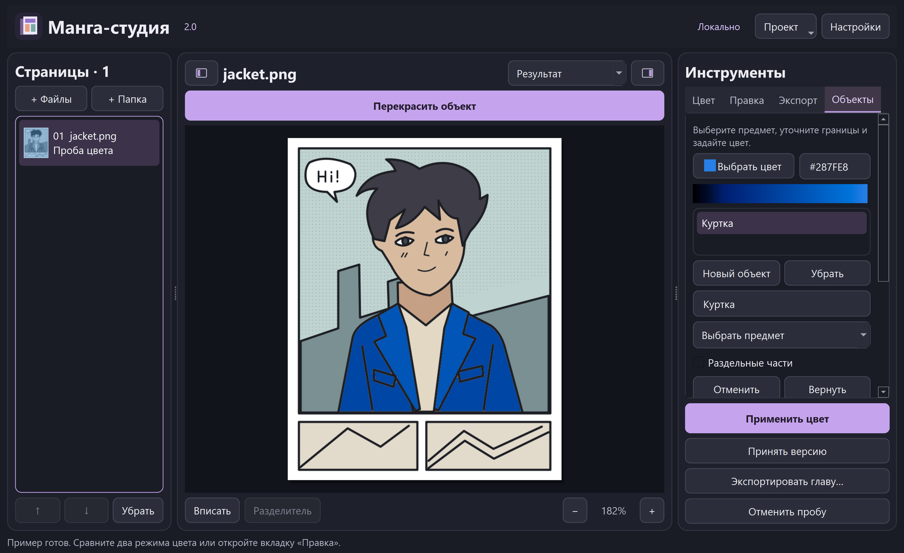

# Манга-студия 2.0

> Историческая документация версии 2.0. Её движок и параметры установки удалены. Для 2.2 используйте [актуальные инструкции](../README.ru.md).

Локальный редактор раскраски для Windows. Выберите предмет, уточните область и задайте цвет материала. Исходный рисунок, предложение модели и редактируемые объекты хранятся отдельно.

**d3l3tanttao** задаёт направление проекта. **OpenAI Codex**, ИИ-ассистент, реализовал приложение, интерфейс, обработку цвета, интеграции, тесты и документацию. Движок раскраски создан **qweasdd**, выделение объектов использует **SAM 2.1 от Meta**. [Вклад участников](../CREDITS.md).



На снимке - собственный демонстрационный рисунок с областями, выбранными инструментом «По контурам». Это пример интерфейса, а не оценка точности SAM.

## Установка

Нужны Windows x64, Python 3.10 x64 с командой `py`, Git и PowerShell.

```powershell
.\setup.ps1 -Device CUDA -InstallEngine -DownloadWeights -InstallSelection
& '.\Manga Studio 2.0.exe'
```

Для CPU замените `CUDA` на `CPU`. Первый запуск и анализ новой страницы занимают больше времени, чем повторное уточнение. Установка проверяет ревизии исходников и SHA256 весов. После установки обработка работает без сети. Изображения не отправляются на сервер.

`-InstallSelection` добавляет SAM 2.1 Small. Для более полной модели доступен параметр `-SelectionModel Large`; в интерфейсе можно переключаться между установленными вариантами. Веса Small занимают около 176 МиБ, Large - 857 МиБ. Он работает непосредственно в Python на Windows, без WSL и сборки необязательного CUDA-расширения. Уточнение границ выполняется нашим кодом на исходном скане. Исходники моделей и веса не входят в архив приложения.

Для знакомства без моделей запустите `setup.ps1 -Device CPU` и нажмите **Попробовать на примере**. Доступны ручные области, материалы, референсы и инструмент **По контурам**. Последний опирается на линии рисунка и не является ИИ-распознаванием.

## Перекраска предмета

1. Нажмите **Перекрасить объект**. Цвет и HEX находятся вверху панели.
2. Нажмите на предмет. Shift или правая кнопка исключают лишнее. Для разнесённых участков включите **Раздельные части** и отметьте каждый из них. Модель анализирует участки отдельно, затем объединяет предложения. Исключающие точки действуют на все части.
3. Проверьте варианты области. Доступны **Добавить участок**, **Исключить участок**, **Лассо области** и **Ограничить кадром**. Диаметр относится к пикселям оригинала. Ctrl+Z отменяет уточнение. Ручные добавления и исключения сохраняются при следующих щелчках ИИ. Варианты, лучше соблюдающие ваши точки, показываются первыми.
4. Нажмите **Применить цвет**, сравните с состоянием до правки, затем **Принять версию** или **Отменить пробу**.
5. **Заблокировать** сохраняет текущие пиксели объекта. В настройках **Вернуть оригинал** защищает выбранную область исходными пикселями. **Защитить фон** предлагает белую область, связанную с краем страницы, и требует проверки.

Белая одежда иногда соединяется с фоном через незамкнутый контур. Автоматические маски являются предложениями. Кожа, волосы и одежда не гарантированно распознаются одним нажатием. Скрытые части тела не дорисовываются.

## Материалы и глава

В настройках объекта доступны насыщенность, светлота и отдельное осветление широких чёрных заливок. На белом участке выбранный HEX воспроизводится с точностью округления, в тенях цвет меняется по оригиналу. Тонкий штрих защищается по исходному рисунку. Разделение штриха и заливки эвристическое, поэтому осветление выключено по умолчанию.

Названия персонажа и материала связывают подтверждённые пользователем объекты между страницами. **Применить к связанным** показывает затронутые объекты и сохраняет новые версии после подтверждения. Автоматическая идентификация персонажей не используется.

**Цвет из референса** берёт медианный цвет из обведённого материала, исключая крайние тёмные и светлые значения, когда это возможно. Геометрия и освещение референса не переносятся.

## Обработка

- **Цвет по оригиналу** сохраняет прежнее поведение и остаётся режимом по умолчанию.
- **Яркость оригинала** сохраняет значение L исходника с ограничением насыщенности в светах и тенях.
- **Цвет и свет** использует границы скана для увеличения цветовой карты и ограничивает изменение светлоты модели.
- **Исходные детали** выполняет шумоподавление перекрывающимися фрагментами без скрытого уменьшения до 1200 пикселей.
- **С уточнением деталей** добавляет локальные проходы с цветовым контекстом всей страницы. Более медленный режим нужно сравнивать с обычным на своём рисунке.
- **Предложить объекты** строит варианты SAM 2.1. **Найти кадры** предлагает прямоугольные рамки. Обе операции требуют проверки.

Проверка качества считает нарушения защиты, несовпадения цвета внутри области объекта, мелкие фрагменты и разные палитры связанных материалов. Она не оценивает художественную правильность и не гарантирует полноту выделения.

## Совместимость и проверки

Проекты 1.1 и 1.2 открываются через отдельную копию. Старые исходники, манифесты и версии остаются на месте. Формат 2.0 хранит маски, материалы, связи, ручные уточнения и защищённые пиксели. Маски связаны с отпечатком исходного изображения; после подмены исходника применение старых областей блокируется. Сохраняйте всю папку главы и исходные изображения для резервной копии.

Экспорт создаёт отдельную папку с PNG в исходном разрешении. Рабочие проекты и проверочные изображения не включаются в исходный архив. Доступны 25 локализаций. Вычитка носителями языка остаётся открытой задачей.

```powershell
.\.venv\Scripts\python.exe tests\check_release.py
.\.venv\Scripts\python.exe tests\check_objects.py --sam
.\.venv\Scripts\python.exe tests\check_desktop.py
```

`tools/evaluate_quality.py` выполняет локальную оценку переданных страниц. [Проверки и ограничения](QUALITY-2.0.md).

Собственная часть приложения распространяется под MIT. Для моделей и библиотек действуют отдельные условия. [Лицензия](../LICENSE) · [Сторонние компоненты](../LICENSING.md).
